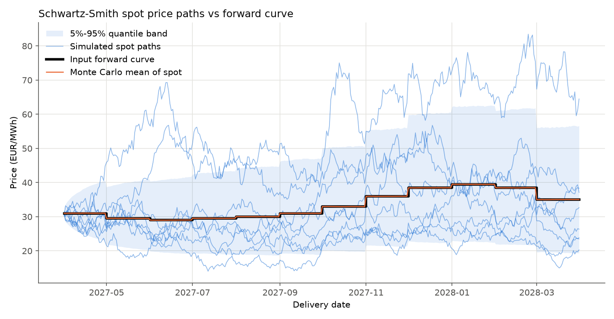
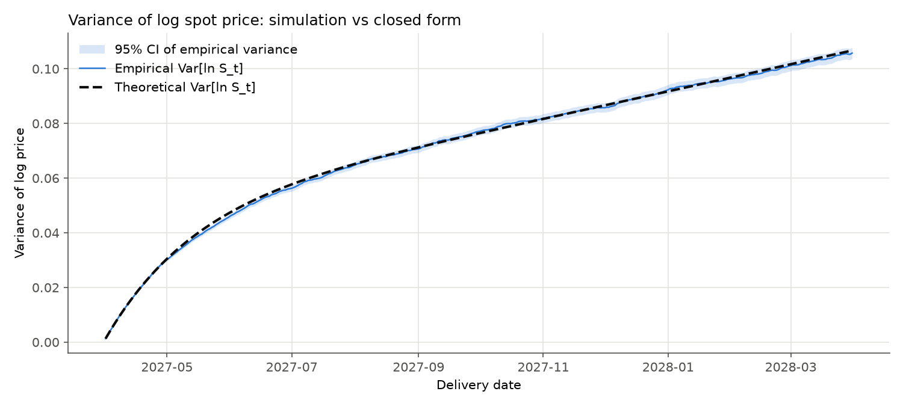
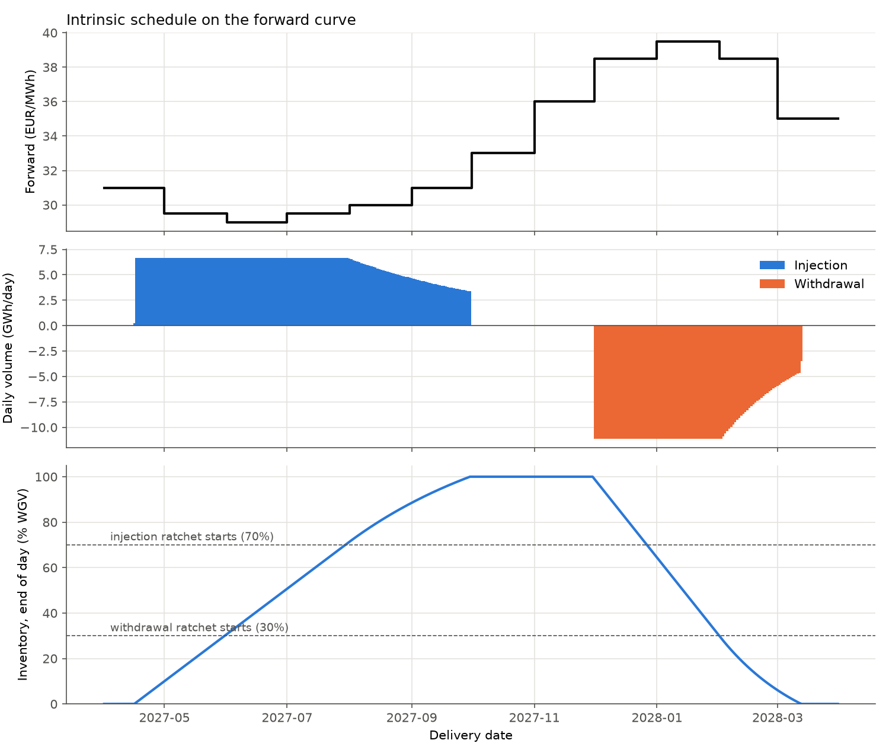
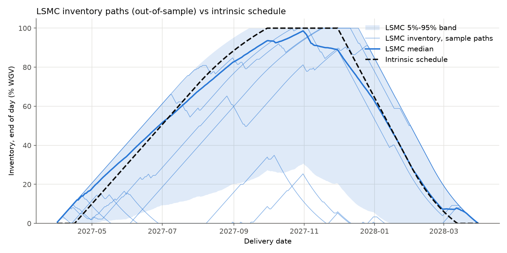
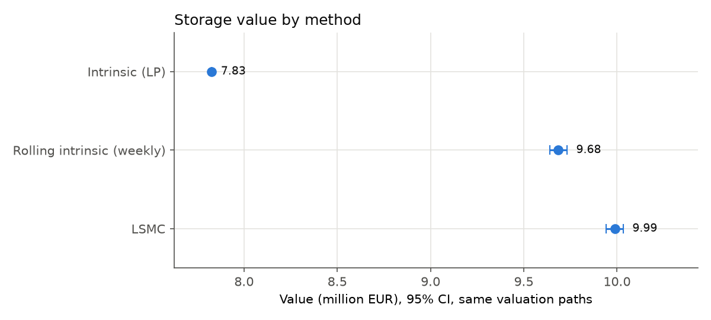
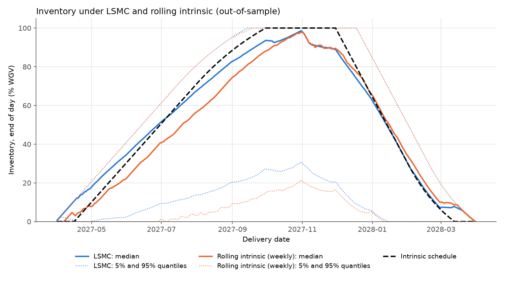
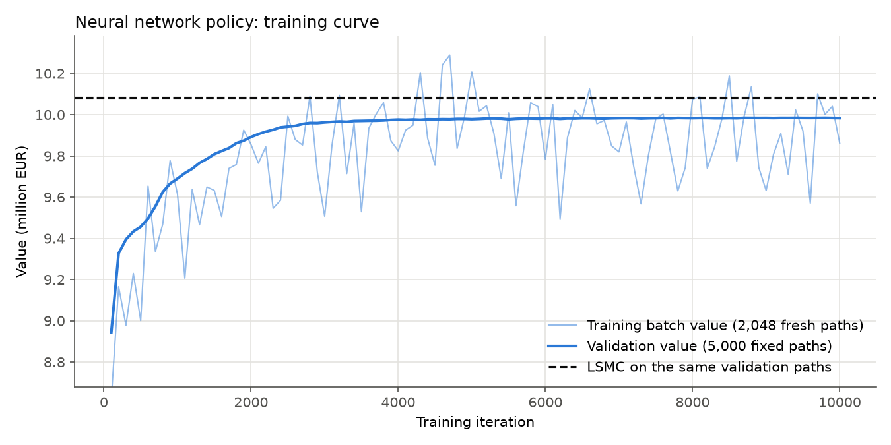
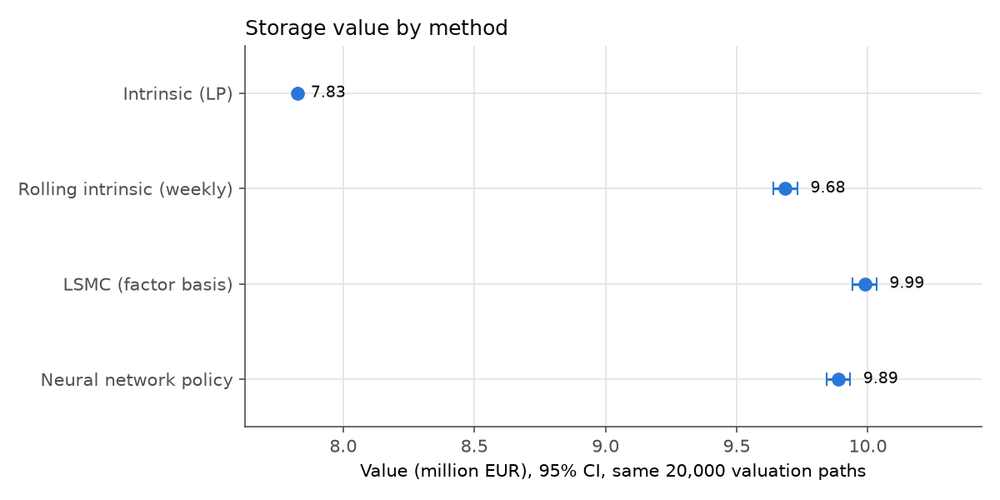
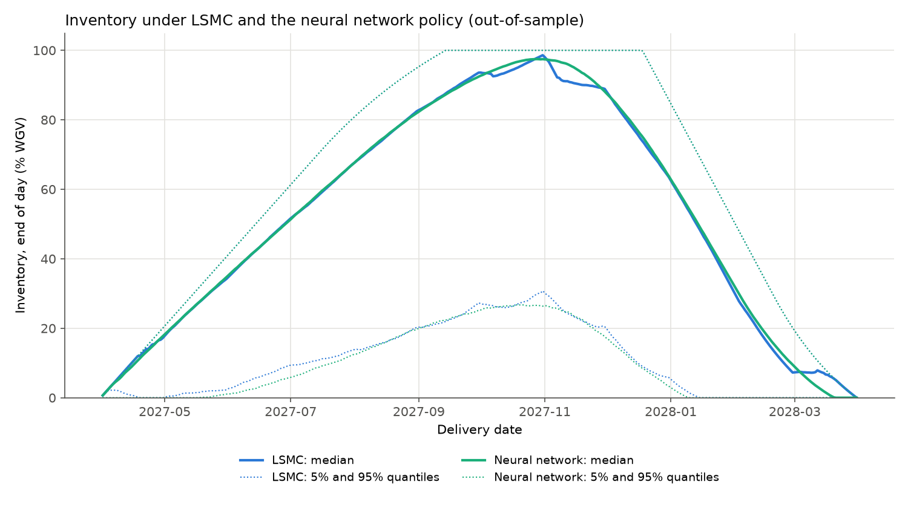

# Natural Gas Storage Valuation

Valuation and optimal operation of a natural gas storage contract, comparing
three methods on the same simulated price paths:

1. Intrinsic and rolling intrinsic value (linear programming on the forward curve)
2. Least-Squares Monte Carlo (Boogert and de Jong, 2008)
3. A neural network policy trained by Monte Carlo gradient (deep-hedging style)

Prices follow a two-factor Schwartz-Smith model with deterministic seasonality
that fits an input forward curve exactly.

**Status: Steps 1 (price model), 2 (intrinsic), 3 (LSMC), 4 (rolling intrinsic) and 5 (neural network policy) are done.**

## Repository layout

```
config/config.toml        all contract, model and simulation parameters
src/config_loader.py      reads the config
src/forward_curve.py      monthly forward curve, daily delivery calendar
src/model.py              Schwartz-Smith model: closed forms and exact simulation
src/contract.py           storage contract: ratchets, cash flows, discounting
src/scenario.py           common setup (contract, curve, discounting) and path simulation
src/intrinsic.py          intrinsic value by LP, plus a DP cross-check
src/lsmc.py               Least-Squares Monte Carlo (Boogert and de Jong)
src/rolling_intrinsic.py  rolling intrinsic (LP re-solved on the model forward curve)
src/nn_policy.py          neural network policy trained by Monte Carlo gradient (PyTorch)
src/evaluation.py         Monte Carlo confidence intervals, checks, tables
scripts/run_step1_checks.py   Step 1 validation run (tables + figures)
scripts/run_step2_intrinsic.py   Step 2 intrinsic valuation and checks
scripts/run_step3_lsmc.py        Step 3 LSMC valuation, variants and bounds
scripts/run_step4_rolling_intrinsic.py   Step 4 rolling intrinsic vs LSMC
scripts/run_step5_nn_policy.py           Step 5 neural network policy vs all methods
tests/                    unit tests (pytest)
results/figures, results/tables   outputs
notebooks/                exploration only
```

## Quick start

```bash
python3 -m venv .venv
.venv/bin/pip install -r requirements.txt
.venv/bin/python -m pytest
.venv/bin/python -m scripts.run_step1_checks
.venv/bin/python -m scripts.run_step2_intrinsic
.venv/bin/python -m scripts.run_step3_lsmc     # about 2.5 minutes
.venv/bin/python -m scripts.run_step4_rolling_intrinsic   # about 40 minutes on 8 cores
.venv/bin/python -m scripts.run_step5_nn_policy           # about 15 minutes
```

## Contract (synthetic TTF-like setup)

| Item | Value |
|---|---|
| Storage year | 1 April 2027 to 31 March 2028 (366 delivery days), daily decisions |
| Valuation date | 31 March 2027 (day before first delivery) |
| Working volume (WGV) | 1,000,000 MWh (1 TWh) |
| Initial / final inventory | 0 / 0 MWh |
| Max injection rate | WGV / 150 = 6,667 MWh/day |
| Max withdrawal rate | WGV / 90 = 11,111 MWh/day |
| Injection ratchet | 100% of max rate up to 70% full, then linear down to 50% at 100% full |
| Withdrawal ratchet | 40% of max rate when empty, linear up to 100% at 30% full, then 100% |
| Injection / withdrawal cost | 0.20 / 0.10 EUR/MWh |
| Discount rate | 3% continuously compounded |

The ratchet applies to the inventory at the start of each day. On day d, with
volume change q_d (q > 0 injection, q < 0 withdrawal):

```
V_{d+1} = V_d + q_d,   0 <= V_d <= WGV,   -W(V_d) <= q_d <= I(V_d)
cash_d  = -S_d q_d - c_inj max(q_d, 0) - c_wd max(-q_d, 0)
```

Both ratchets are **concave** functions of the inventory, so each one is the
minimum of its affine pieces. The constraint `q_d <= I(V_d)` can then be written
as several linear constraints `q_d <= a_k + b_k V_d`, and the intrinsic problem
stays a linear program.

## Price model

Under the pricing measure Q:

```
ln S_t = f(t) + chi_t + xi_t
d chi_t = -kappa chi_t dt + sigma_chi dW1_t          (short-term, OU)
d xi_t  = mu_xi dt + sigma_xi dW2_t                  (long-term, ABM)
d<W1, W2>_t = rho dt
```

Parameters: kappa = 4.0, sigma_chi = 0.70, sigma_xi = 0.25, rho = -0.2,
mu_xi = 0, chi_0 = xi_0 = 0.

**Exact simulation.** Over a step dt, (chi, xi) has a Gaussian transition with

```
Var(chi) = sigma_chi^2 (1 - e^{-2 kappa dt}) / (2 kappa)
Var(xi)  = sigma_xi^2 dt
Cov      = rho sigma_chi sigma_xi (1 - e^{-kappa dt}) / kappa
```

It is sampled with a 2x2 Cholesky factor, vectorised over paths. There is no
discretisation error.

**Futures prices.** With tau = T - t and V(tau) = Var(chi + xi) over tau:

```
F(t, T) = exp( f(T) + e^{-kappa tau} chi_t + xi_t + mu_xi tau + V(tau) / 2 )
```

**Seasonal term.** The input curve is monthly. Each delivery day takes its
month's forward (a step curve), and

```
f(T) = ln F_input(T) - E[chi_T + xi_T] - V(T) / 2
```

so that F(0, T) = F_input(T) exactly for every day. Any risk premium or drift
that is constant in time only adds a deterministic term to ln S, so it is
absorbed by f.

## Step 1 results (20,000 paths, seed 20270401)

All Monte Carlo numbers come with 95% confidence intervals. Full output is in
`results/step1_output.txt` and `results/tables/`.

**Check 1: MC mean of the monthly average spot vs input forward.** All 12
months contain the forward in their CI. |z| <= 1.42 and the largest relative
error is 0.11%.

**Check 2: Var[ln S_t] vs closed form.** The largest relative error over all
366 days is 3.5% (chi-square CIs). Coverage for this seed is 86.6% of days.
Days along a path are strongly autocorrelated, so this number is noisy: over
20 seeds the average coverage is 93.5%. A 1,000,000-path run confirms Var(chi),
Var(xi) and Cov(chi, xi) to within about 0.3% at several dates, all inside the
CIs.

**Check 3: futures martingale.** At t = 30 Sep 2027, the MC mean of the model
monthly futures F(t, T) for Oct 2027 to Mar 2028 contains F(0, T) in its CI
for all 6 months.

**Contract sanity checks.** At the maximum rate it takes 168 days to fill
(continuous-time value 167.4) and 104 days to empty (104.2). A full cycle fits
in the storage year.





## Step 2: intrinsic value by linear programming

The intrinsic value is the value of the best schedule fixed today against the
forward curve. It can be locked in with forwards, so it is a lower bound of the
storage value. Formulation (`src/intrinsic.py`), with volumes in units of WGV:

```
max  sum_d DF_d [ (F_d - c_wd) w_d - (F_d + c_inj) i_d ]
s.t. V_{d+1} = V_d + i_d - w_d,   0 <= V_d <= 1,   V_0 = V_init,  V_N = V_final
     i_d <= a_k + b_k V_d   (each affine piece of the concave injection ratchet)
     w_d <= a_k + b_k V_d   (each affine piece of the concave withdrawal ratchet)
     i_d, w_d >= 0
```

Modelling choices: daily decisions on the daily step forward curve; ratchets
applied to start-of-day inventory; hard terminal condition V_N = 0. The LP
has 1,099 variables and 1,830 constraints, and HiGHS solves it in 0.02 s.

**Intrinsic value: 7,826,175 EUR (7.83 EUR/MWh of WGV).** The schedule injects
from mid-April to the end of September, filling to 100% (the injection ratchet
slows it above 70%), stays idle in October and November, and withdraws from
1 December to mid-March (the withdrawal ratchet slows it below 30%).

| Check | Result |
|---|---|
| Constraint violations of the schedule, rebuilt outside the LP | <= 1.2e-8 MWh; no day with both injection and withdrawal |
| Value recomputed from the schedule's cash flows | equal to the LP objective (difference 9e-10 EUR) |
| DP on an inventory grid (a lower bound of the LP) | gap 1.07% (500 MWh step) -> 0.25% (100) -> 0.08% (25) |
| DP vs LP when rates are multiples of the grid (unit test) | equal to 1e-9 relative |
| Fixed schedule on 20,000 simulated spot paths | MC mean 7,781,832 EUR, 95% CI [7,641,936, 7,921,728], contains the LP value (z = -0.62) |

The last check holds because E[S_d] = F(0, d) and the schedule is fixed, so
the expected cash flows are linear in the forwards. The standard deviation of
the path values (10.1M EUR) is the spot risk of the schedule if it is left
unhedged. The intrinsic value is risk-free only once it is hedged with forwards.




## Step 3: Least-Squares Monte Carlo

The method follows Boogert and de Jong (2008) (`src/lsmc.py`). It works
backward from the last day, on 10,000 regression paths:

- **Continuation value.** For each day and each of the 101 inventory grid
  levels, the realised future value is regressed on all monomials of total
  degree <= 3 in the standardised factors (chi, xi), which is 10 terms (basis
  "factors", the full state of the price model). There is one least-squares
  solve per day, with one right-hand side per grid level. A spot-only basis
  (1, S, S^2, S^3) is available as `basis = "spot"`.
- **Actions (bang-bang).** Withdraw at the maximum rate, do nothing, or inject
  at the maximum rate. The next inventory is usually between grid levels, so
  the continuation value is interpolated linearly.
- **Realised values.** They are updated in the Longstaff-Schwartz way: the
  actual cash flows along the path, not the fitted values.
- **Hard terminal constraint.** The reachable band [L_d, U_d] is the set of
  inventories from which V_final can still be reached under the ratchets.
  Every action keeps the inventory inside it, so every out-of-sample path ends
  at exactly V_final (forced withdrawal near maturity).
- **Grid (default "adaptive").** The 101 levels are equally spaced on
  [L_d, U_d] each day, so every level is feasible. The alternative "fixed"
  grid on [0, WGV] needs a terminal penalty (1,000 EUR/MWh) for levels outside
  the band, and it undervalues the storage (see below).
- **Valuation.** The policy is valued only on 20,000 fresh paths (different
  seed). The fixed intrinsic schedule on the same paths has a known
  expectation (the LP value), so it is used as a control variate.

### Results (base case: adaptive grid, 101 levels, factor basis of degree 3)

| Estimate | Value (EUR) | 95% CI |
|---|---|---|
| Intrinsic (LP) | 7,826,175 | exact |
| LSMC out-of-sample | 9,916,565 | [9,795,729, 10,037,401] |
| LSMC out-of-sample, control variate (CI 2.7x narrower) | 9,987,588 | [9,942,886, 10,032,291] |
| Extrinsic = LSMC - intrinsic | 2,161,414 (27.6% of intrinsic) | [2,116,711, 2,206,116] |
| LSMC in-sample (biased upward) | 10,083,384 | [9,912,133, 10,254,635] |
| Perfect foresight, 1,000 paths (upper bound) | 14,860,254 | [14,319,207, 15,401,300] |

All 20,000 out-of-sample schedules are feasible (largest violation 3e-11 MWh,
terminal inventory exactly 0). With almost zero volatility, LSMC recovers the
intrinsic value to within -0.055% (unit test). The perfect-foresight bound is
loose, as expected with 70% short-term volatility.

### Sensitivities (paired differences vs base on the same 20,000 paths)

| Variant | Difference vs base (EUR), 95% CI |
|---|---|
| Spot basis (1, S, S^2, S^3) | -791,259 [-830,209, -752,309] |
| Fixed grid [0, WGV] + penalty | -182,827 [-191,620, -174,035] |
| Degree 2 / 4 (factor basis) | -14,181 [-17,983, -10,380] / -1,353 [-3,999, 1,294] |
| 2,500 / 5,000 / 20,000 regression paths | -23,598 [-29,777, -17,418] / -6,614 [-10,135, -3,093] / +3,154 [-79, 6,388] |
| 51 / 201 levels | +1,128 [159, 2,097] / -36 [-1,072, 1,000] |
| 5 actions (partial volumes allowed) | -118 [-777, 541] |

What the sensitivities show:
- **The basis matters most.** The spot price only reveals chi + xi. A high
  price caused by chi (temporary) and one caused by xi (permanent) call for
  different decisions, and only the factor basis can tell them apart.
- **Degree 3 is needed; degree 4 adds nothing.**
- **Regression paths:** 10,000 is within about 3,000 EUR (0.03%) of 20,000.
- **Grid and actions have converged.** The adaptive grid at 51 levels is
  enough, and bang-bang is enough (partial volumes are 2% of trades and add
  nothing).
- **The fixed grid undervalues by 183k.** Near maturity, its levels above the
  reachable band carry the penalty, and interpolation pulls it into feasible
  inventories.



## Step 4: rolling intrinsic

Rolling intrinsic (`src/rolling_intrinsic.py`) re-solves the intrinsic LP
every 7 days. It starts from the current inventory and uses the model forward
curve F(t_d, T) at that date (for day d itself, F(t_d, t_d) = S_d), then
executes the plan until the next re-optimisation. In practice each plan is
locked in with forwards. The re-hedging P&L has zero expectation under Q, so
the value is the expected discounted spot cash flow of the executed volumes.
It runs on all 20,000 valuation paths (1.06M LPs, 31 minutes on 8 processes).

| Estimate (same 20,000 paths, 95% CI) | Value (EUR) |
|---|---|
| Intrinsic (LP) | 7,826,175 |
| Rolling intrinsic, weekly | 9,684,960 [9,638,830, 9,731,090] |
| LSMC (factor basis) | 9,987,588 [9,942,886, 10,032,291] |
| Rolling intrinsic - intrinsic | 1,858,785 [1,812,655, 1,904,916] |
| LSMC - rolling intrinsic weekly (paired) | 302,341 [285,547, 319,135] |
| Share of the LSMC extrinsic value captured by weekly RI | 86.1% [85.3%, 86.9%] |
| Daily - weekly RI (paired, first 500 paths) | 158,751 [111,065, 206,436] |
| LSMC - daily RI (paired, first 500 paths) | 148,549 [38,162, 258,936] |

The ordering matches the literature: intrinsic < rolling intrinsic weekly <
rolling intrinsic daily < LSMC < perfect foresight. Rolling intrinsic is a
heuristic that ignores the option to wait for better prices, but it still
captures 86% of the extrinsic value with weekly re-hedging. It beats LSMC on
42% of individual paths, but not on average.

An earlier run with the spot basis found the opposite (rolling intrinsic above
LSMC by 489k). That is what led to the diagnosis of the basis and the switch to
factors. Per-path values for all methods are saved in
`results/tables/step4_path_values.npz` for paired comparisons in later steps.





## Step 5: neural network policy

The policy (`src/nn_policy.py`) is one network for all days (an MLP with 2 x 64
SiLU units and a sigmoid output) that returns a fraction a in [0, 1] of the
feasible trade interval:

```
q_d = q_lo + a (q_hi - q_lo),   q_lo = max(-W(V), L_{d+1} - V),   q_hi = min(I(V), U_{d+1} - V)
inputs: time left, fill level, position in the reachable band [L_d, U_d], standardised chi_d, xi_d
```

Every action is feasible by construction (ratchets, capacity and the hard
terminal condition), so no penalty is needed. In torch, the ratchets are the
minimum of their affine pieces: exact and differentiable. The network is
trained like deep hedging: maximise the mean discounted cash flow by
backpropagation through the 366 daily steps, with Adam (learning rate 1e-3,
cosine decay to 5e-5) and 10,000 iterations of 2,048 fresh paths (41 minutes
on CPU). A separate validation set (5,000 paths) selects the best weights. The
value is measured only on the 20,000 valuation paths.

| Estimate (same 20,000 paths, 95% CI) | Value (EUR) |
|---|---|
| Intrinsic (LP) | 7,826,175 |
| Rolling intrinsic, weekly | 9,684,960 [9,638,830, 9,731,090] |
| Neural network policy | 9,886,893 [9,841,590, 9,932,195] |
| LSMC (factor basis) | 9,987,588 [9,942,886, 10,032,291] |
| NN - LSMC (paired) | -101,107 [-108,068, -94,146] |
| NN - rolling intrinsic (paired) | +201,234 [185,489, 216,980] |
| NN extrinsic / LSMC extrinsic | 95.4% [95.0%, 95.7%] |

All 20,000 schedules are feasible (largest violation 2e-11 MWh). The network
learns an almost bang-bang policy: 85% of trades are at the full ratchet rate.
Its inventory distribution (median and 5%/95% quantiles) nearly overlaps
LSMC's.

**Training length.** A first run with 3,000 iterations (archived in
`results/archive/step5_3000_iterations/`) reached only 9,744,576 and was still
improving at the end. With 10,000 iterations the value gains +140,998
[126,484, 155,513] (paired, same paths). Most of the gain comes from keeping
the learning rate high for longer. The validation value has been flat since
about iteration 4,000, so this network has converged. The remaining 1% gap to
LSMC is likely structural: a sigmoid policy trained by pathwise gradient only
sees the bang-bang decision boundaries through its smooth transition region.





**Unit tests:** 79 tests pass (`pytest`).
